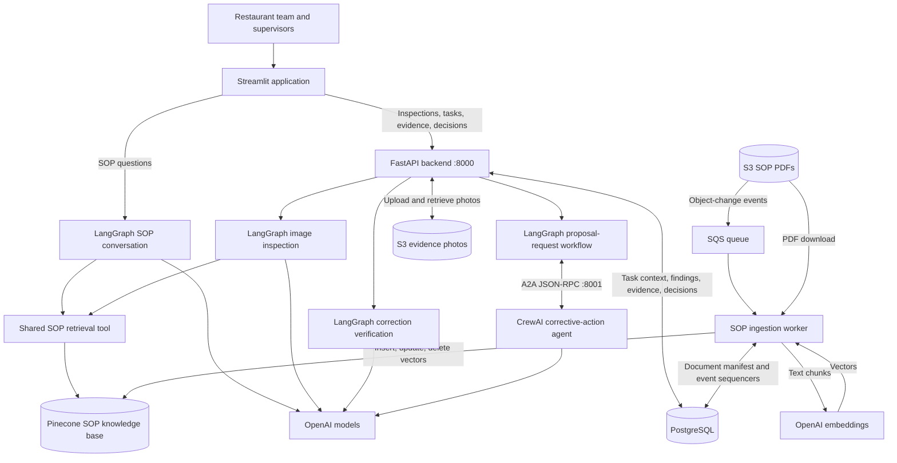
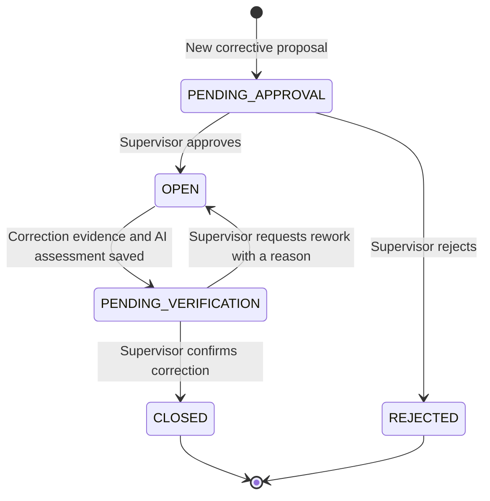
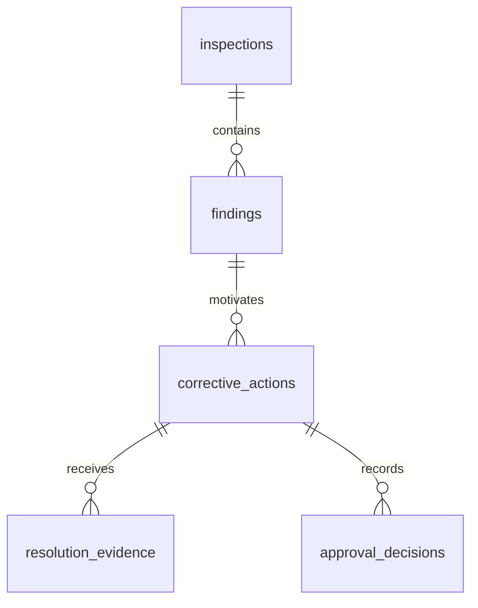

# Food Compliance AI

## Goal

Help restaurant teams identify potential food safety issues, find relevant standard operating procedures (SOPs), and track corrective actions through supervisor review and closure.

The application combines photo analysis with retrieved SOP evidence across four categories: **Food Handler Hygiene**, **Kitchen Cleanliness**, **Food Storage**, and **Equipment Cleanliness**.

I built the entire UI with help from Codex.

## What the Application Does

| Page | Function |
| --- | --- |
| Conversation | Answers restaurant SOP questions using the shared knowledge base and maintains conversation context during the session. |
| Image Inspection | Accepts one photo, a manually selected category, and an optional note. Assesses visible conditions against retrieved SOP passages and creates corrective proposals for potential violations. |
| Corrective Actions | Lists approved, open tasks and accepts one correction photo and an optional note per attempt. |
| Category Supervisor | Reviews corrective proposals and correction evidence for the selected category. Approves or rejects proposals, then closes tasks or requests rework. |
| Head Supervisor | Displays corrective tasks across categories, with category filtering and counts by status. |

Inspection results distinguish `NO_ISSUE_OBSERVED`, `POTENTIAL_VIOLATION`, and `INSUFFICIENT_EVIDENCE`. Findings include the visible observation, an SOP requirement, its retrieved source, and an advisory correction. Missing visual evidence is not treated as proof that something is absent.

Before drafting a new corrective proposal, the application checks unresolved tasks for the same finding and asks the corrective-action agent to identify possible duplicates within the selected category. A supervisor must approve a proposal before it becomes an open task. Correction verification compares the original and correction photos against the saved finding and SOP evidence; the supervisor makes the final closure decision.

## Why CrewAI and A2A?

I used LangGraph for inspections, correction verification, and SOP questions, and kept corrective-action planning separate in CrewAI. If I adapt the application for other restaurants, each may have different rules for drafting proposals and reviewing findings. This separation lets me change the corrective-action workflow without having to redesign the inspection workflow. CrewAI also gives me room to expand corrective-action planning into multiple specialized agents as those needs grow.

I connected the two through A2A so they communicate through a defined interface and can evolve independently. Another LangGraph agent could handle the same task, but I also wanted hands-on experience connecting agents built with different frameworks.

## Components

| Component | Responsibility | Location |
| --- | --- | --- |
| Streamlit | Five application pages, photo uploads, chat, supervisor decisions, and dashboard counts. | `streamlit_app.py` |
| FastAPI | Inspection processing, corrective proposals, evidence submission, supervisor decisions, and task retrieval. | `backend/main.py` |
| LangGraph | SOP conversation, image inspection, correction verification, and the workflow that requests corrective proposals. | `agents/workflows.py` |
| CrewAI | Drafts SOP-grounded corrective proposals and identifies possible duplicate unresolved tasks. | `agents/corrective_actions.py` |
| A2A | Connects the proposal-request workflow to the separate corrective-action agent over JSON-RPC. | `agents/a2a_client.py`, `agents/a2a_server.py` |
| OpenAI | Provides language and image analysis through `gpt-4o-mini`, and embeddings for SOP retrieval. | `agents/`, `tools/`, `rag_pipeline/` |
| Pinecone and retrieval tool | Stores SOP passage embeddings and retrieves up to three passages per search, with source and page metadata. | `tools/rag_tool.py` |
| PostgreSQL | Stores document ingestion metadata, inspections, findings, corrective tasks, correction attempts, and supervisor decisions. | `backend/db.py`, `rag_pipeline/clients/db_client.py`, `database/` |
| Amazon S3 | Stores SOP PDFs and inspection/correction photos. PostgreSQL stores photo bucket/key references. | `backend/storage.py`, `rag_pipeline/clients/s3_client.py` |
| Amazon SQS and ingestion worker | Delivers SOP object-change events for PDF extraction, chunking, embedding, and Pinecone updates or deletions. | `rag_pipeline/` |
| Output schemas and prompts | Define categories, structured model responses, and instructions for the agent workflows. | `schemas/schema.py`, `agents/prompts.py` |

## High-Level Architecture

The SOP conversation runs directly from Streamlit; inspection and corrective-action operations go through FastAPI. Both conversation and inspection use the same Pinecone knowledge base. Correction verification reuses the SOP evidence saved with the original finding. CrewAI receives the finding, its SOP evidence, and unresolved category tasks through A2A.

The ingestion worker processes SOP PDF creation, replacement, and deletion events. It records S3 event sequencers to skip stale or duplicate events and retains deleted-document records to reject delayed older events.

### Corrective-Action Lifecycle

Task state changes are performed by database operations with approval-state checks. Each correction attempt is retained, and closure decisions must refer to the latest evidence.

## Database Schema

PostgreSQL contains six tables. The five inspection and corrective-action tables are defined in `database/*.sql`. The `documents` table is used by the ingestion pipeline; its creation SQL is not included in the repository, so the fields below describe the code's usage rather than verified database constraints or exact SQL types.

### `documents`

Tracks SOP indexing and the last successfully processed S3 event for each document.

| Column | Value used by ingestion code | Purpose |
| --- | --- | --- |
| `id` | UUID | Document identifier; also forms the prefix of its Pinecone vector IDs. |
| `s3_key` | String | SOP PDF object key. |
| `content_hash` | SHA-256 hexadecimal string | Hash of the extracted text chunks. |
| `status` | String: `Indexed` or `Deleted` | Document indexing state. |
| `last_sequencer` | Hexadecimal string or null | Last successfully processed S3 event sequence. |
| `chunk_count` | Integer | Number of indexed chunks; zero for deleted documents. |

Pinecone vector IDs follow `<document_id>:<chunk_index>`. Each vector stores the chunk text, source S3 URI, zero-based PDF page number, and document ID as metadata. There is no SQL foreign key between `documents` and the inspection tables; findings retain their retrieved SOP passage and metadata in JSONB.

### `inspections`

One row per inspection submission.

| Column | SQL type | Constraints / purpose |
| --- | --- | --- |
| `id` | `UUID` | Primary key. |
| `category` | `TEXT` | Required; one of the four inspection categories. |
| `s3_bucket` | `TEXT` | Required; original photo bucket. |
| `s3_key` | `TEXT` | Required; original photo object key. |
| `description` | `TEXT` | Optional inspection note. |
| `assessment` | `TEXT` | Required; `NO_ISSUE_OBSERVED`, `POTENTIAL_VIOLATION`, or `INSUFFICIENT_EVIDENCE`. |
| `summary` | `TEXT` | Required; inspection summary. |
| `evidence_limitations` | `TEXT[]` | Required; defaults to an empty array. |
| `created_at` | `TIMESTAMPTZ` | Required; defaults to the current timestamp. |

### `findings`

One row per potential violation identified in an inspection.

| Column | SQL type | Constraints / purpose |
| --- | --- | --- |
| `id` | `UUID` | Primary key. |
| `inspection_id` | `UUID` | Required foreign key to `inspections.id`. |
| `observation` | `TEXT` | Required; visible condition identified in the photo. |
| `sop_requirement` | `TEXT` | Required; applicable SOP requirement. |
| `sop_reference` | `JSONB` | Required; retrieved reference ID, passage text, and source metadata. |
| `advisory_correction` | `TEXT` | Required; suggested correction grounded in the SOP. |

### `corrective_actions`

Stores proposed corrective tasks and their current status.

| Column | SQL type | Constraints / purpose |
| --- | --- | --- |
| `id` | `UUID` | Primary key. |
| `finding_id` | `UUID` | Required foreign key to `findings.id`. |
| `category` | `TEXT` | Required; one of the four inspection categories. |
| `title` | `TEXT` | Required; task title. |
| `description` | `TEXT` | Required; corrective instructions. |
| `status` | `TEXT` | Required; defaults to `PENDING_APPROVAL`. Allowed values: `PENDING_APPROVAL`, `OPEN`, `PENDING_VERIFICATION`, `CLOSED`, `REJECTED`. |
| `created_at` | `TIMESTAMPTZ` | Required; defaults to the current timestamp. |
| `closed_at` | `TIMESTAMPTZ` | Optional; populated when the supervisor closes the task. |

### `resolution_evidence`

Stores each correction attempt separately, including its photo reference and AI assessment.

| Column | SQL type | Constraints / purpose |
| --- | --- | --- |
| `id` | `UUID` | Primary key. |
| `task_id` | `UUID` | Required foreign key to `corrective_actions.id`. |
| `s3_bucket` | `TEXT` | Required; correction photo bucket. |
| `s3_key` | `TEXT` | Required; correction photo object key. |
| `description` | `TEXT` | Optional correction note. |
| `ai_verification` | `JSONB` | Required; structured correction assessment, summary, observations, and evidence limitations. |
| `created_at` | `TIMESTAMPTZ` | Required; defaults to the current timestamp. |

### `approval_decisions`

Records supervisor decisions for proposals and task closure.

| Column | SQL type | Constraints / purpose |
| --- | --- | --- |
| `id` | `UUID` | Primary key. |
| `task_id` | `UUID` | Required foreign key to `corrective_actions.id`. |
| `approval_type` | `TEXT` | Required; `PROPOSAL` or `CLOSURE`. |
| `decision` | `TEXT` | Required; schema allows `APPROVE`, `REJECT`, `REVISE`, `CLOSE`, or `REOPEN`. Current endpoints use `APPROVE`/`REJECT` for proposals and `CLOSE`/`REOPEN` for closure. |
| `reason` | `TEXT` | Optional in SQL; the application requires a reason for `REOPEN`. |
| `created_at` | `TIMESTAMPTZ` | Required; defaults to the current timestamp. |

### Table Relationships

An inspection can produce several findings. Each corrective action references one finding and can accumulate multiple correction attempts and supervisor decisions. SOP document ingestion is tracked separately in `documents`.
